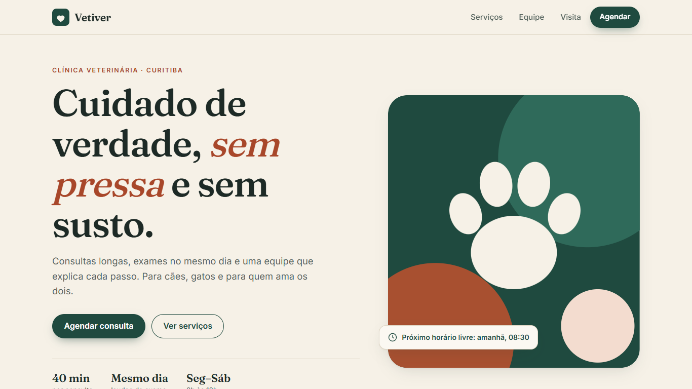
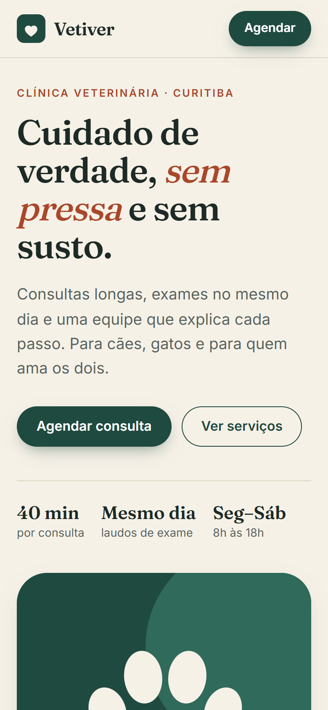

# Vetiver — veterinary clinic website

Portfolio demo of a small veterinary clinic site: services, team and an interactive online booking flow.
**Live:** https://alissonlittig.github.io/vetiver-vet/

> Vetiver is a fictional brand. All names, prices, addresses, phone numbers and professional registrations are made up. Nothing entered in the booking form leaves the browser.




## Features
- Service catalogue, team profiles with working days
- Booking flow: service → vet → day → time slot → pet details. Slots respect each vet's working days, opening hours (Sat closes at 13:00), lunch break and service duration; a deterministic fake agenda marks some slots as taken
- Responsive down to 390 px, keyboard-accessible (radio-based controls, skip link, visible focus), reduced-motion aware
- Lighthouse (production build): accessibility 100, SEO 100, best practices ≥ 96

## Stack
SvelteKit 2 (Svelte 5 runes) with `adapter-static`, self-hosted variable fonts (Fraunces + Inter), Vitest, GitHub Actions → GitHub Pages.

## Run
```sh
npm ci
npm test        # unit tests for the booking logic (src/lib/agenda.js)
npm run dev
BASE_PATH=/vetiver-vet npm run build   # static output in ./out
```
